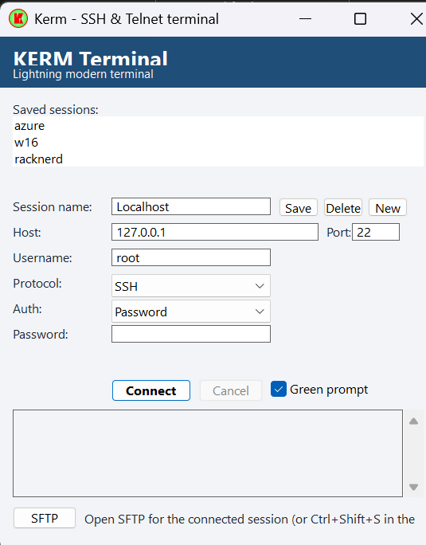
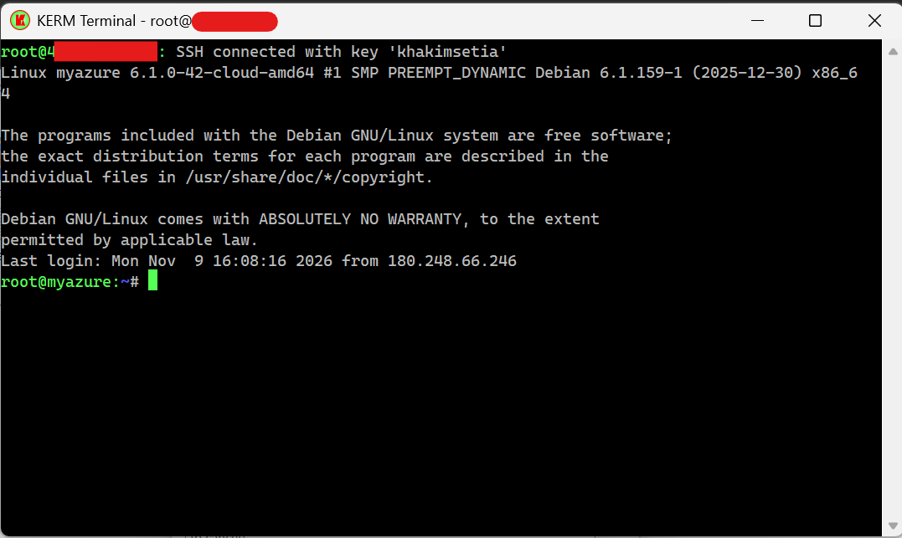
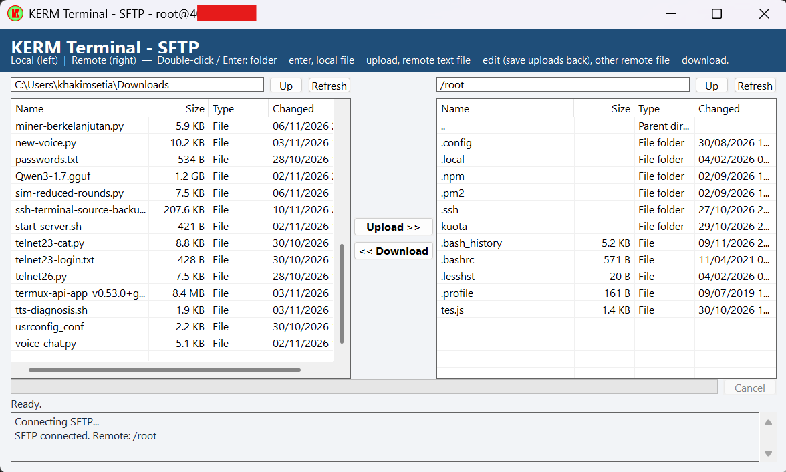

# KERM Terminal

Aplikasi terminal SSH & Telnet untuk Windows, ala PuTTY, dibuat dengan
Go + Win32 murni tanpa runtime tambahan.
Satu file `.exe`, portable: extract lalu jalankan.

> Build ini **unsigned**, jadi Windows SmartScreen bisa muncul saat pertama
> kali dijalankan. Lihat bagian [Keamanan](#keamanan).

**Pembuat:** Khakimsetia, dibantu Muse.ai.

## Screenshot





## Fitur

- **SSH** ke server apa pun (VPS, localhost, LAN) dengan password atau key.
- **Prompt hijau khas KERM**: `user@host` hijau dan direktori biru, diwarnai
  di sisi klien tanpa mengubah PS1 server, jadi tidak ada prompt ganda.
- **Key langsung, tanpa konversi**: file `.ppk` PuTTY v2/v3 (RSA, ECDSA,
  Ed25519, plain maupun passphrase Argon2id/Argon2i) dan key OpenSSH/`.pem`
  bisa dipakai langsung. Argon2d, DSA, dan Ed448 belum didukung.
- **Verifikasi host key**: pertama kali ke sebuah server, fingerprint SHA256
  ditampilkan untuk dikonfirmasi dan disimpan. Kalau fingerprint berubah,
  muncul peringatan keras — jangan dikonfirmasi sembarangan.
- **Telnet** untuk perangkat LAN (hanya jaringan lokal/tepercaya, karena
  Telnet tidak terenkripsi — ada peringatan di aplikasi).
- **Banyak terminal, satu panel**: satu proses, satu panel sesi, banyak
  jendela terminal. Tutup panel saat terminal jalan hanya menyembunyikan
  panel; tutup satu terminal menampilkan panel lagi, terminal lain tetap jalan.
- **Terminal lengkap untuk pemakaian sehari-hari**: warna PuTTY, layar
  alternatif (vim, nano, htop, tmux), scrollback tanpa batas, scroll dengan
  roda mouse / Shift+PgUp / Shift+PgDn / Shift+Home / Shift+End, seleksi
  mouse + auto-copy saat lepas klik, copy Ctrl+Shift+C, paste Ctrl+V,
  klik kanan untuk copy/paste, tombol dan mouse xterm (termasuk F5–F12,
  Ctrl/Alt/Shift+panah, dan mouse reporting untuk aplikasi seperti htop).
- **Sesi tersimpan**: simpan, muat, dan hapus sesi dari panel. Password dan
  passphrase **tidak pernah** disimpan.
- **SFTP gaya WinSCP** (tombol `SFTP` di panel, atau `Ctrl+Shift+S` di
  terminal): dua panel (kiri lokal, kanan server), kolom Name / Size / Type /
  Changed, `..` untuk kembali, upload, download, cek timpa sebelum menulis
  (tidak pernah menimpa diam-diam), rename, hapus (dengan konfirmasi),
  buat folder baru, tombol Delete di panel server, dan pemilih terminal
  kalau ada lebih dari satu terminal SSH terhubung.
- **Edit file server di editor teks**: Enter / double-click file teks di
  panel server (json, conf, txt, dan sejenisnya) membukanya di Notepad++
  (kalau ada) atau Notepad. Setiap Save di editor langsung di-upload balik
  ke server. File biner tetap di-download biasa, bukan dibuka di editor.
- **Notifikasi gagal connect**: kalau server timeout (10 detik) atau tidak
  terhubung, muncul popup simpel — judul "Connection Timeout" dan satu baris
  "Error connect SSH failed: host:port i/o timeout" — bukan cuma satu baris
  di status log.
- **Pemberitahuan putus koneksi**: putus yang tidak normal (jaringan putus,
  laptop sleep, server restart) tidak membuat terminal hilang diam-diam —
  terminal tetap terbuka dengan keterangan putusnya, dan masih bisa
  di-scroll / di-copy.

## Cara pakai (portable)

1. Download rilis / build, extract ZIP-nya.
2. Klik 2x `kerm-terminal.exe`. Tidak perlu install, tidak perlu admin.
3. Di panel sesi, isi Host / Port / Username, pilih Auth `Password` atau
   `Key (OpenSSH / .ppk)`, lalu klik **Connect** (atau **Save** dulu untuk
   menyimpan sesi, klik nama sesi untuk memuatnya, klik 2x untuk langsung
   connect).
4. Pertama kali ke sebuah server, cocokkan fingerprint SHA256 yang tampil,
   klik **Yes** untuk menyimpan dan lanjut.
5. Terminal terbuka. Tutup jendela terminal = putus koneksi, kembali ke panel.
   Tutup panel saat tidak ada terminal = keluar aplikasi.

Jalan pintas penting:

| Aksi | Cara |
| --- | --- |
| Buka SFTP untuk terminal ini | `Ctrl+Shift+S` di terminal |
| Buka SFTP dari panel | Tombol `SFTP` di bawah status log |
| SFTP: masuk folder / upload / edit / download | Double-click atau Enter di list |
| SFTP: path langsung (mis. `D:\node`) | Ketik di kolom path, tekan Enter |
| SFTP: hapus file server | Klik kanan → Delete, atau tombol Delete |
| SFTP: rename / folder baru | Klik kanan di panel server |
| Panel sesi dari terminal | `Ctrl+Shift+N` di terminal |

Sesi dan host key yang sudah dikonfirmasi tersimpan di
`%APPDATA%\SSHTerminal\` (`sessions.json` dan `known_hosts.txt`).
File sementara Edit tersimpan di `%TEMP%\KERM-SFTP\`.

## Build dari source

Kebutuhan: **Go 1.26 atau lebih baru**. Dependensi diunduh otomatis lewat
`go.mod` saat pertama kali build (butuh internet sekali itu saja).

```sh
# 1. Test (bisa di Linux maupun Windows, test-nya Go murni)
go test ./...

# 2. Cek vet untuk Windows
GOOS=windows GOARCH=amd64 go vet .

# 3a. Build di Windows (langsung, tanpa GOOS/GOARCH juga bisa)
go build -trimpath -ldflags "-H windowsgui -s -w" -o kerm-terminal.exe .

# 3b. Build dari Linux (cross-compile, tanpa Wine)
GOOS=windows GOARCH=amd64 go build -trimpath -ldflags "-H windowsgui -s -w" -o kerm-terminal.exe .
```

Hasilnya satu file `kerm-terminal.exe` GUI (tanpa console window),
Windows 64-bit (x64) saja.

**Icon:** `rsrc_windows_amd64.syso` sudah jadi di repo ini, jadi build biasa
tidak perlu tool icon. Rebuild `.syso` hanya perlu kalau `icon.ico` atau
`app.manifest` berubah:

```sh
go install github.com/akavel/rsrc@latest
rsrc -manifest app.manifest -ico icon.ico -o rsrc_windows_amd64.syso -arch amd64
```

## Struktur project

| File | Isi |
| --- | --- |
| `main_windows.go`, `winapi.go` | UI Win32: panel sesi + jendela terminal |
| `vt.go` | Emulator terminal VT/xterm |
| `ssh.go`, `ppk.go`, `ppk_b64.go` | Koneksi SSH, verifikasi host key, konversi `.ppk` |
| `telnet.go` | Klien Telnet (LAN saja) |
| `keys.go`, `selection.go`, `disconnect.go`, `wm_size.go` | Kode tombol, seleksi, putus koneksi, resize |
| `sftp.go`, `sftp_ui.go`, `sftp_edit.go`, `sftp_input.go`, `sftp_pick.go` | Mesin + UI SFTP, Edit di editor, dialog input, pemilih terminal |
| `*_test.go` | Test: VT, `.ppk`, SSH lokal, SFTP, tombol, dan lain-lain |
| `app.manifest`, `icon.ico`, `rsrc_windows_amd64.syso` | Manifest DPI-aware, icon, resource icon embedded |

## Keamanan

- **Password dan passphrase tidak pernah disimpan.** Di `sessions.json`
  hanya ada nama sesi, host, port, username, protokol, dan path file key —
  bukan isi key, bukan password. (Bug lama yang sempat menulis password
  ke `sessions.json` sudah diperbaiki; kalau memakai versi lama, simpan
  ulang tiap sesi atau hapus `sessions.json` dan buat ulang.)
- **Host key diverifikasi**, bukan diterima buta. Fingerprint yang berubah
  diberi peringatan keras.
- **Telnet tidak terenkripsi.** Pakai hanya di LAN / jaringan tepercaya,
  jangan pernah ke VPS lewat internet.
- **File sementara Edit** ada di `%TEMP%\KERM-SFTP\` dan sengaja tidak
  dihapus saat jendela SFTP ditutup, supaya editan yang sudah tersimpan
  tidak hilang dan tidak mengganggu editor yang mungkin masih terbuka.
- **Unsigned.** Sampai ada sertifikat code signing, Windows SmartScreen
  bisa muncul. Itu normal untuk EXE unsigned, bukan tanda file rusak —
  pastikan file berasal dari sumber yang kamu percaya sebelum
  `More info > Run anyway`.

## Batasan yang diketahui

Sejujurnya, ini bukan klon PuTTY 100%. Yang belum ada (dan bukan target
versi ini): port forwarding, X11/agent forwarding, jump host/proxy,
Serial/Raw, pembuatan/konversi key (pakai PuTTYgen untuk itu), log sesi ke
file, fullscreen Alt+Enter, dan pengaturan font/warna/scrollback di UI.
Emoji / karakter CJK lebar dihitung 1 sel, jadi kursor bisa bergeser di
baris yang banyak emojinya. SFTP tidak transfer folder rekursif (folder
hanya untuk navigasi, file satu per satu).

## Lisensi

Proyek ini dilisensikan di bawah **MIT License** — lisensi open source
standar yang memperbolehkan siapa pun memakai, menyalin, mengubah,
menggabungkan, menerbitkan, mendistribusikan, dan menjual salinan
perangkat lunak ini, dengan syarat pemberitahuan hak cipta dan lisensi
ikut disertakan. Lihat file [`LICENSE`](LICENSE) untuk teks lengkapnya.

Pembuat: Khakimsetia, dibantu Muse.ai.
